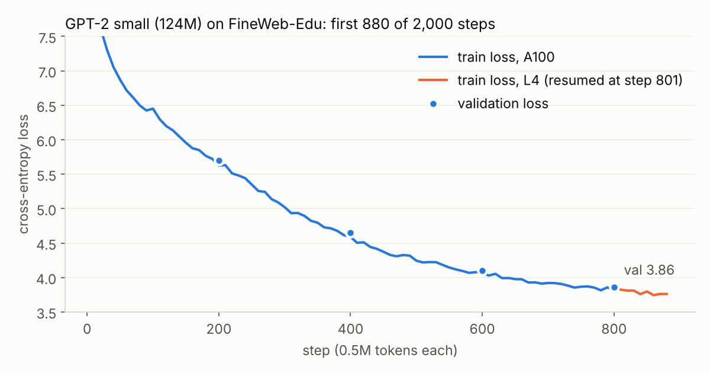
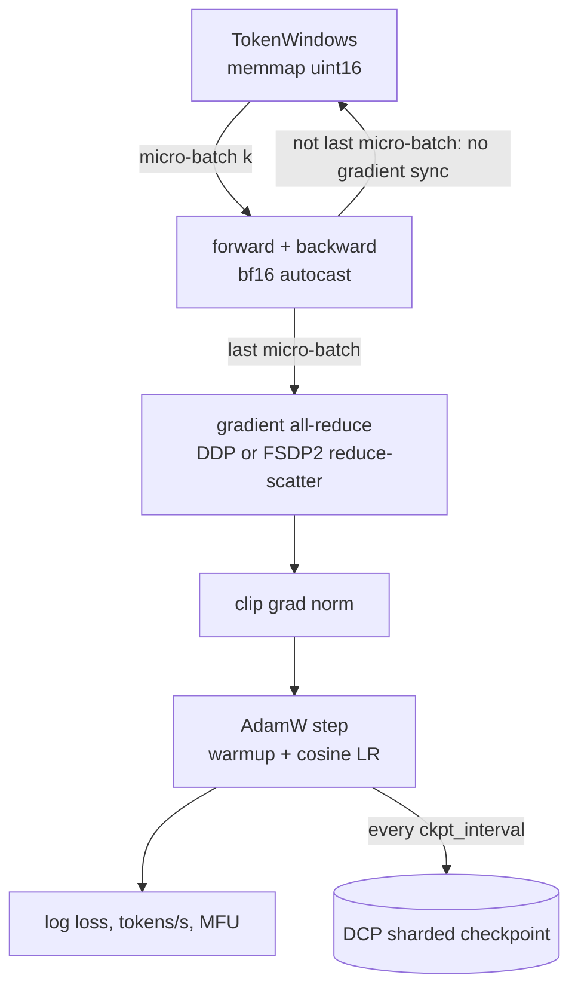

# distributed-llm-training: GPT pre-training from one GPU to many

[](https://github.com/kishorhange111/distributed-llm-training/actions/workflows/ci.yml)


A compact GPT-2-style pre-training stack in plain PyTorch. The same training loop runs on one GPU, with DDP, or with FSDP2 sharding. It handles mixed precision, activation checkpointing, `torch.compile`, gradient accumulation, sharded checkpoints with exact resume, and MFU accounting. The trained model exports to Hugging Face format.

**Author:** Kishor Hange

<!-- RESULTS:START -->
## Results

All runs are on Google Colab: one A100-SXM4-40GB, and an L4 for the resumed part of the pre-training run. Raw numbers are in [`results/colab/`](results/colab).

### Memory and throughput ablation (A100, 30 steps each)

GPT-2 medium (354M non-embedding parameters), micro-batch 8 × 1,024 tokens:

| Configuration | Tokens/s | vs. first row | MFU | Peak memory |
|---|---:|---:|---:|---:|
| fp32 eager | 7,620 | 1.0× | 6 % | 22.2 GB |
| bf16 autocast | 54,087 | 7.1× | 42 % | 16.8 GB |
| bf16 + torch.compile | 64,553 | 8.5× | 50 % | 13.9 GB |
| bf16 + compile + activation ckpt | 55,278 | 7.3× | 43 % | 7.2 GB |
| FSDP2 (bf16 mixed precision) | not measured (launcher bug, since fixed) | | | |
| FSDP2 + CPU offload | not measured (launcher bug, since fixed) | | | |

GPT-2 XL (1.56B), micro-batch 4 × 1,024 tokens:

| Configuration | Tokens/s | vs. first row | MFU | Peak memory |
|---|---:|---:|---:|---:|
| fp32 eager | out of memory | | | |
| bf16 autocast | 13,160 | 1.0× | 43 % | 34.1 GB |
| bf16 + torch.compile | 14,421 | 1.1× | 47 % | 32.7 GB |
| bf16 + compile + activation ckpt | 12,217 | 0.9× | 40 % | 24.9 GB |
| FSDP2 (bf16 mixed precision) | not measured (launcher bug, since fixed) | | | |
| FSDP2 + CPU offload | not measured (launcher bug, since fixed) | | | |

What this shows: bf16 autocast is the big win (7× over fp32 on GPT-2 medium, because the A100's tensor cores need bf16). `torch.compile` adds another 19 % by fusing kernels and also lowers peak memory. Activation checkpointing trades about 15 % throughput for roughly half the activation memory, which is what lets GPT-2 XL train in 25 GB instead of 33 GB; in fp32 XL does not fit at all. The two FSDP2 rows failed in this run because the benchmark launched `torchrun` without the `-m` flag; the bug is fixed (`scripts/benchmark.py`) but the rows were not re-run.

### Pre-training GPT-2 small on FineWeb-Edu



| | |
|---|---|
| Model | GPT-2 small, 124M parameters, 1,024-token context |
| Batch | 0.5M tokens per step (32 × 16 × 1,024 on the A100; 16 × 32 × 1,024 on the L4) |
| Throughput | 192k tokens/s at **52 % MFU** on the A100 (bf16 + `torch.compile`); 38k tokens/s, 27 % MFU on the L4 |
| Progress | 880 of the planned 2,000 steps (about 460M tokens) |
| Validation loss | 10.36 → 5.70 (step 200) → 4.65 (400) → 4.10 (600) → **3.86 (800)** |

The run was interrupted twice when the Colab runtime was lost. The second time it **resumed on a different GPU type** from the step-800 sharded checkpoint, with a different micro-batch / accumulation split that keeps the same 0.5M-token batch; the loss continues smoothly from where it left off. It was stopped at step 880 because the connection to the runtime kept dropping, so the planned HellaSwag evaluation of the final model was not run.
<!-- RESULTS:END -->

## What is implemented

| Feature | Where | Notes |
|---|---|---|
| GPT-2 architecture, presets tiny → XL (1.5B) | `model.py` | Fused SDPA attention, weight tying, optional activation checkpointing per block |
| Single / DDP / FSDP2 | `strategies.py` | FSDP2 via `fully_shard` with a bf16 `MixedPrecisionPolicy`, optional CPU offload |
| Gradient accumulation without wasted all-reduces | `train.py` | `no_sync()` for DDP, `set_requires_gradient_sync(False)` for FSDP2 on all but the last micro-batch |
| Sharded checkpoints | `checkpoint.py` | `torch.distributed.checkpoint`: every rank writes its own shards; old checkpoints are pruned |
| Exact resume | `data.py`, `train.py` | Batch *k* depends only on (seed, rank, *k*), so a resumed run sees the same data as an uninterrupted one |
| Throughput and MFU | `metrics.py` | 6N + attention FLOPs per token, against the GPU's bf16 peak |
| Data pipeline | `scripts/prepare_fineweb.py` | FineWeb-Edu, GPT-2 tokenizer, memory-mapped `uint16` token files |
| Hugging Face export | `export.py` | Converts to `GPT2LMHeadModel`; a test checks the logits match |

## How a training step works



Global batch = micro-batch × accumulation steps × number of GPUs. The GPT-2 small config uses 32 × 16 × 1024 tokens = 0.5M tokens per step, the batch size GPT-3 used for its small models. On N GPUs, set `grad_accum` to 16 / N to keep it.

## Quickstart

```bash
pip install -e ".[data]"
python -m disttrain.train --config configs/smoke.yaml                 # a few steps on random tokens, any device

python scripts/prepare_fineweb.py --tokens 1050000000 --out data/fineweb
python -m disttrain.train --config configs/gpt2_small_fineweb.yaml    # one GPU
torchrun --nproc_per_node 4 -m disttrain.train --config configs/gpt2_small_fineweb.yaml --strategy fsdp --grad_accum 4

python scripts/benchmark.py --preset gpt2-medium --micro_batch 8      # memory/throughput ablation
python -m disttrain.export runs/gpt2_small_fineweb out/hf_model       # Hugging Face format
```

Any config key can be overridden on the command line (`--lr 1e-3 --compile true`). Re-running the same command resumes from the newest checkpoint in `out_dir`.

On Google Colab, `scripts/colab_job.sh bench` and `scripts/colab_job.sh train` run the two experiments. Runtimes can be reclaimed mid-run, so the training config checkpoints every 50 steps, and a run resumes from the newest checkpoint.

## How correctness is tested

Multi-GPU behaviour is tested on CPU: the tests start several processes with the `gloo` backend, the same way `torchrun` would. They check that:

- DDP over 2 ranks gives the same gradients as one process on the combined batch;
- gradient accumulation with skipped syncs gives the same update as one large batch;
- FSDP2 training matches unsharded training step for step;
- the full training loop runs under DDP and FSDP2, checkpoints, resumes at the right step and prunes old checkpoints;
- indexed data sampling is identical after a resume;
- the Hugging Face export produces the same logits as the original model.

```bash
pip install -e ".[dev]"
pytest
```

`make check` runs the same lint and test steps as CI, and `make help` lists the other commands. Optionally, `pip install pre-commit && pre-commit install` runs ruff before every commit.

## Project layout

```
distributed-llm-training/
├── src/disttrain/              # the training library (installable package)
│   ├── model.py                #   GPT, presets, activation checkpointing
│   ├── distributed.py          #   process-group setup from torchrun env vars, seeding, collectives
│   ├── strategies.py           #   single / DDP / FSDP2 wrapping, grad clipping for sharded params
│   ├── data.py                 #   memory-mapped token windows
│   ├── checkpoint.py           #   sharded save / load / prune
│   ├── metrics.py              #   FLOPs per token, MFU, throughput
│   ├── train.py                #   config, LR schedule, training loop (python -m disttrain.train)
│   └── export.py               #   Hugging Face conversion
├── configs/                    # smoke test, GPT-2 small on FineWeb-Edu
├── scripts/                    # FineWeb preparation, benchmark suite, Colab job
├── results/colab/              # raw benchmark + training logs behind every number above
├── tests/                      # CPU tests, incl. 2-process DDP / FSDP on the gloo backend
├── .github/workflows/ci.yml    # lint + tests on every push and pull request
├── Makefile                    # make install / install-dev / lint / test / smoke / bench
└── pyproject.toml              # package metadata, dependencies, ruff + pytest config
```

## Limitations

- Colab provides one GPU per runtime, so the multi-GPU code paths are verified by the multi-process CPU tests, not by multi-GPU timing runs. The FSDP2 code path is therefore tested for correctness, not timed.
- No tensor or pipeline parallelism; FSDP2 alone covers models up to a few billion parameters.
- The data loader samples random windows (with replacement), as nanoGPT does, rather than making exact epochs.

## License

MIT
