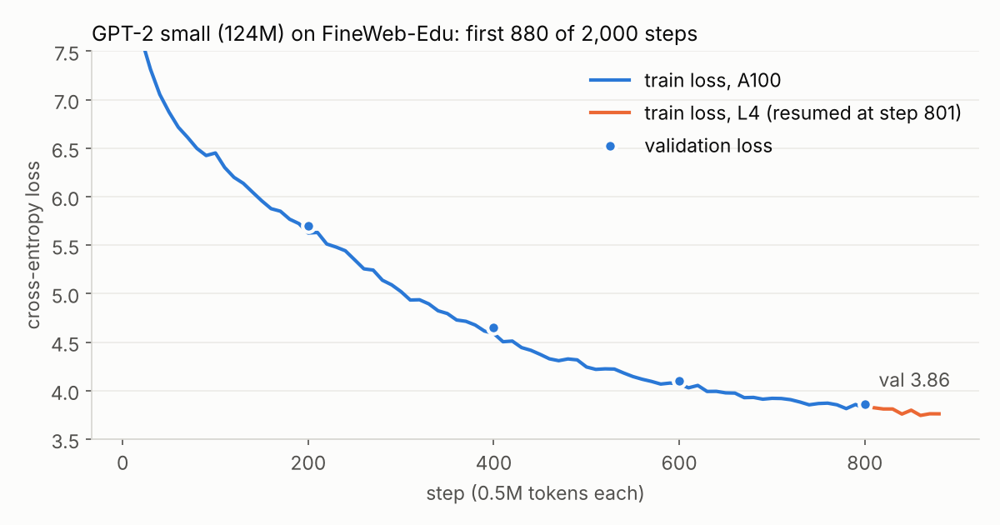
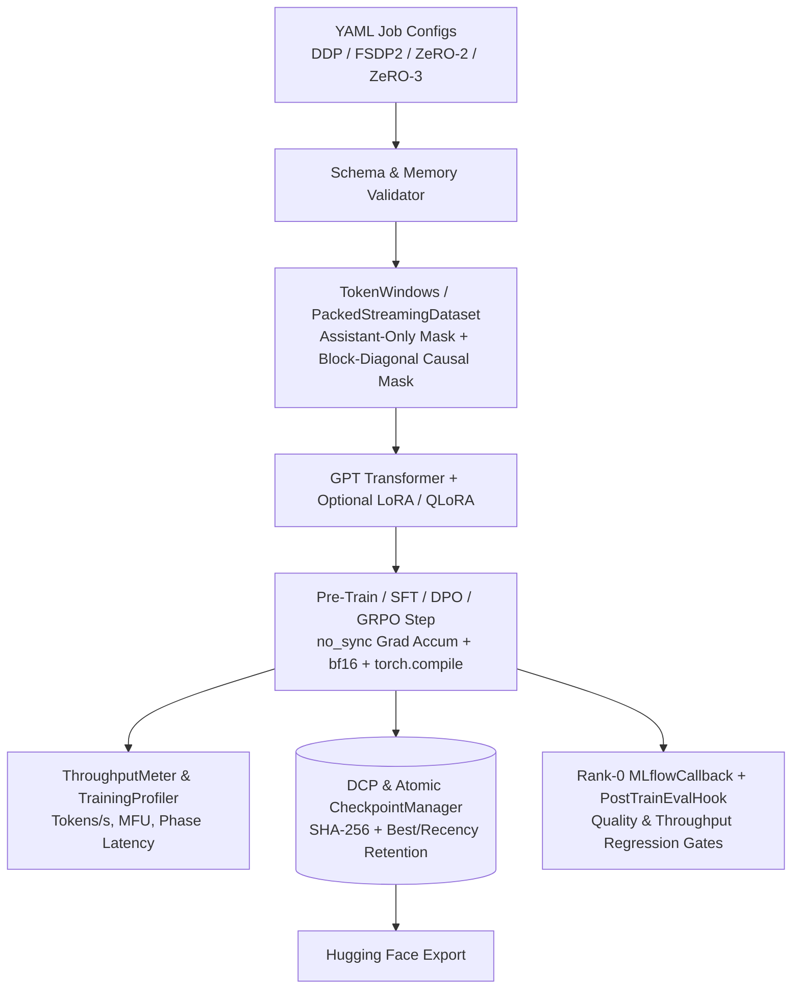

# distributed-llm-training: Production LLM Pre-Training & Post-Training Stack

[](https://github.com/kishorhange111/distributed-llm-training/actions/workflows/ci.yml)


An end-to-end, production-oriented PyTorch LLM training stack that scales from single-GPU prototyping to multi-node distributed training with **DDP, FSDP2, and DeepSpeed ZeRO-2/ZeRO-3**. Covers the full lifecycle: declarative YAML config validation, packed streaming dataloaders with assistant-only loss masking, **LoRA / QLoRA** adapters, **SFT / DPO / GRPO** post-training objectives, atomic crash-safe checkpointing, analytical GPU memory & **MFU** profiling, **MLflow** experiment tracking with automated post-train eval gates, Hugging Face export, and **Kubernetes PyTorchJob / TorchElastic** manifests.

**Author:** Kishor Hange

<!-- RESULTS:START -->
## Results

All runs are on Google Colab: one A100-SXM4-40GB, and an L4 for the resumed part of the pre-training run. Raw numbers are in [`results/colab/`](results/colab).

### Memory and throughput ablation (A100, 30 steps each)

GPT-2 medium (354M non-embedding parameters), micro-batch 8 × 1,024 tokens:

| Configuration | Tokens/s | vs. first row | MFU | Peak memory |
|---|---:|---:|---:|---:|
| fp32 eager | 7,620 | 1.0× | 6 % | 22.2 GB |
| bf16 autocast | 54,087 | 7.1× | 42 % | 16.8 GB |
| bf16 + torch.compile | 64,553 | 8.5× | 50 % | 13.9 GB |
| bf16 + compile + activation ckpt | 55,278 | 7.3× | 43 % | 7.2 GB |
| FSDP2 (bf16 mixed precision) | not measured (launcher bug, since fixed) | | | |
| FSDP2 + CPU offload | not measured (launcher bug, since fixed) | | | |

GPT-2 XL (1.56B), micro-batch 4 × 1,024 tokens:

| Configuration | Tokens/s | vs. first row | MFU | Peak memory |
|---|---:|---:|---:|---:|
| fp32 eager | out of memory | | | |
| bf16 autocast | 13,160 | 1.0× | 43 % | 34.1 GB |
| bf16 + torch.compile | 14,421 | 1.1× | 47 % | 32.7 GB |
| bf16 + compile + activation ckpt | 12,217 | 0.9× | 40 % | 24.9 GB |
| FSDP2 (bf16 mixed precision) | not measured (launcher bug, since fixed) | | | |
| FSDP2 + CPU offload | not measured (launcher bug, since fixed) | | | |

What this shows: bf16 autocast is the big win (7× over fp32 on GPT-2 medium, because the A100's tensor cores need bf16). `torch.compile` adds another 19 % by fusing kernels and also lowers peak memory. Activation checkpointing trades about 15 % throughput for roughly half the activation memory, which is what lets GPT-2 XL train in 25 GB instead of 33 GB; in fp32 XL does not fit at all. The two FSDP2 rows failed in this run because the benchmark launched `torchrun` without the `-m` flag; the bug is fixed (`scripts/benchmark.py`) but the rows were not re-run.

### Pre-training GPT-2 small on FineWeb-Edu



| | |
|---|---|
| Model | GPT-2 small, 124M parameters, 1,024-token context |
| Batch | 0.5M tokens per step (32 × 16 × 1,024 on the A100; 16 × 32 × 1,024 on the L4) |
| Throughput | 192k tokens/s at **52 % MFU** on the A100 (bf16 + `torch.compile`); 38k tokens/s, 27 % MFU on the L4 |
| Progress | 880 of the planned 2,000 steps (about 460M tokens) |
| Validation loss | 10.36 → 5.70 (step 200) → 4.65 (400) → 4.10 (600) → **3.86 (800)** |

The run was interrupted twice when the Colab runtime was lost. The second time it **resumed on a different GPU type** from the step-800 sharded checkpoint, with a different micro-batch / accumulation split that keeps the same 0.5M-token batch; the loss continues smoothly from where it left off. It was stopped at step 880 because the connection to the runtime kept dropping, so the planned HellaSwag evaluation of the final model was not run.
<!-- RESULTS:END -->

## Architecture & Capabilities



| Capability | Module | Highlights |
|---|---|---|
| **Modular Configs & Validator** | `config.py`, `configs/*.yaml` | Composable YAML schemas for DDP, FSDP2, DeepSpeed ZeRO-2 & ZeRO-3, invariant checks, DeepSpeed JSON export |
| **Packed Streaming Data** | `packed_data.py`, `data.py` | Memmap `uint16` windows + sequence packing with position resets, block-diagonal causal mask, assistant-only loss masking |
| **PEFT (LoRA / QLoRA)** | `lora.py` | Target-module selector (skips `lm_head`), simulated 4-bit/8-bit blockwise QLoRA, zero-init equivalence, lossless merge |
| **Post-Training Alignment** | `alignment.py` | `SFTStep`, `DPOStep` (implicit reward margin & accuracy), `GRPOStep` (group advantages, PPO clip, k3 KL) |
| **Parallelism Strategies** | `strategies.py`, `distributed.py` | Single / DDP / FSDP2 (`fully_shard`, bf16 `MixedPrecisionPolicy`, CPU offload), `no_sync()` gradient accumulation |
| **Fault-Tolerant Checkpointing** | `checkpoint.py`, `checkpoint_manager.py` | DCP sharded save/load + two-phase atomic staging commits, SHA-256 verification, best + recency pruning |
| **Profiler & MFU Accounting** | `profiler.py`, `metrics.py` | Analytical per-GPU memory estimator across ZeRO stages, 6N + attention FLOPs MFU, phase profiler with JSON export |
| **MLOps & Eval Gates** | `callbacks.py` | Rank-0 `MLflowCallback` (live client + offline CI fallback) and `PostTrainEvalHook` regression gates |
| **Kubernetes & Containers** | `Dockerfile`, `deploy/k8s/` | Non-root container image, Kubeflow `PyTorchJob` FSDP manifest, and spot-ready `TorchElastic` (`c10d`) manifest |
| **Hugging Face Export** | `export.py` | Converts trained weights to `GPT2LMHeadModel` with logit-equivalence tests |

## Quickstart

```bash
pip install -e ".[dev]"

# Run the full CPU test suite (including 2-process gloo DDP & FSDP2 tests)
pytest

# Smoke test the native training loop on CPU
python -m disttrain.train --config configs/smoke.yaml

# Multi-GPU FSDP2 launch
torchrun --nproc_per_node 4 -m disttrain.train --config configs/gpt2_small_fineweb.yaml --strategy fsdp --grad_accum 4

# Deploy on Kubernetes (Kubeflow Training Operator)
kubectl apply -f deploy/k8s/pytorchjob-fsdp.yaml
kubectl apply -f deploy/k8s/torchelastic-job.yaml
```

## Architecture Decision Records (ADRs)

- [ADR 001: Parallelism Strategy Selection (DDP, FSDP2, DeepSpeed ZeRO-2/ZeRO-3)](docs/adr/001-parallelism-and-zero-sharding.md)
- [ADR 002: Sequence Packing, Assistant-Only Loss Masking, and Post-Training Alignment](docs/adr/002-sequence-packing-and-alignment.md)
- [ADR 003: Fault-Tolerant Checkpointing, TorchElastic, and Automated Post-Train Eval Gates](docs/adr/003-fault-tolerant-checkpointing-and-mlops.md)

## Project Layout

```text
distributed-llm-training/
├── src/disttrain/
│   ├── model.py                # GPT-2 transformer, presets (tiny -> XL), activation checkpointing
│   ├── config.py               # Modular DDP / FSDP2 / DeepSpeed ZeRO-2 & ZeRO-3 YAML schemas & validator
│   ├── distributed.py          # Process-group setup, rank seeding, collectives
│   ├── strategies.py           # Single / DDP / FSDP2 wrapping, global grad-norm clipping
│   ├── data.py                 # Memory-mapped uint16 token windows with resume-exact indexing
│   ├── packed_data.py          # Packed streaming dataloader, assistant-only masking, block-diagonal mask
│   ├── lora.py                 # LoRA & simulated 4-bit/8-bit QLoRA adapters, target selector, merge
│   ├── alignment.py            # SFT, DPO, and GRPO losses & trainer step abstractions
│   ├── checkpoint.py           # Sharded DCP save / load / prune
│   ├── checkpoint_manager.py   # Atomic staging checkpoints, SHA-256 verification, best+recency retention
│   ├── metrics.py              # FLOPs/token, MFU, ThroughputMeter
│   ├── profiler.py             # Analytical GPU memory estimator & phase-level TrainingProfiler
│   ├── callbacks.py            # Rank-0 MLflowCallback & automated PostTrainEvalHook
│   ├── train.py                # Unified training loop (python -m disttrain.train)
│   └── export.py               # Hugging Face GPT2LMHeadModel conversion
├── configs/                    # Smoke, FineWeb-Edu, DDP, FSDP ZeRO-3, DeepSpeed ZeRO-2/3 YAML configs
├── deploy/k8s/                 # Kubeflow PyTorchJob & TorchElastic manifests
├── docs/adr/                   # Training systems Architecture Decision Records
├── scripts/                    # FineWeb preparation, benchmark suite, Colab job
├── results/colab/              # Raw A100/L4 benchmark & pre-training logs
├── tests/                      # 100% CPU-runnable unit, multi-process gloo, and manifest tests
├── Dockerfile                  # Non-root container image for torchrun / Kubeflow jobs
└── .github/workflows/ci.yml    # Ruff lint/format + pytest CI
```

## License

MIT
