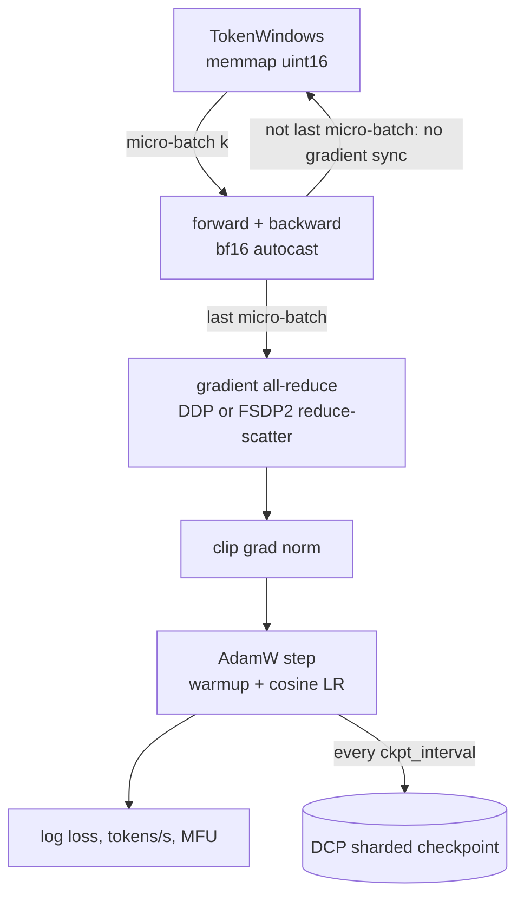

# distributed-llm-training: GPT pre-training from one GPU to many

[](https://github.com/kishorhange111/distributed-llm-training/actions/workflows/ci.yml)


A compact GPT-2-style pre-training stack in plain PyTorch. The same training loop runs on one GPU, with DDP, or with FSDP2 sharding. It handles mixed precision, activation checkpointing, `torch.compile`, gradient accumulation, sharded checkpoints with exact resume, and MFU accounting. The trained model exports to Hugging Face format.

**Author:** Kishor Hange

<!-- RESULTS:START -->
## Results

_The Colab runs for this section are in progress. It will hold the memory and throughput ablation (fp32 → bf16 → compile → activation checkpointing → FSDP2 → CPU offload) on GPT-2 medium and XL, and a GPT-2 small (124M) model pre-trained on about 1B FineWeb-Edu tokens, with its loss curve and HellaSwag score._
<!-- RESULTS:END -->

## What is implemented

| Feature | Where | Notes |
|---|---|---|
| GPT-2 architecture, presets tiny → XL (1.5B) | `model.py` | Fused SDPA attention, weight tying, optional activation checkpointing per block |
| Single / DDP / FSDP2 | `strategies.py` | FSDP2 via `fully_shard` with a bf16 `MixedPrecisionPolicy`, optional CPU offload |
| Gradient accumulation without wasted all-reduces | `train.py` | `no_sync()` for DDP, `set_requires_gradient_sync(False)` for FSDP2 on all but the last micro-batch |
| Sharded checkpoints | `checkpoint.py` | `torch.distributed.checkpoint`: every rank writes its own shards; old checkpoints are pruned |
| Exact resume | `data.py`, `train.py` | Batch *k* depends only on (seed, rank, *k*), so a resumed run sees the same data as an uninterrupted one |
| Throughput and MFU | `metrics.py` | 6N + attention FLOPs per token, against the GPU's bf16 peak |
| Data pipeline | `scripts/prepare_fineweb.py` | FineWeb-Edu, GPT-2 tokenizer, memory-mapped `uint16` token files |
| Hugging Face export | `export.py` | Converts to `GPT2LMHeadModel`; a test checks the logits match |

## How a training step works



Global batch = micro-batch × accumulation steps × number of GPUs. The GPT-2 small config uses 32 × 16 × 1024 tokens = 0.5M tokens per step, the batch size GPT-3 used for its small models. On N GPUs, set `grad_accum` to 16 / N to keep it.

## Quickstart

```bash
pip install -e ".[data]"
python -m disttrain.train --config configs/smoke.yaml                 # a few steps on random tokens, any device

python scripts/prepare_fineweb.py --tokens 1050000000 --out data/fineweb
python -m disttrain.train --config configs/gpt2_small_fineweb.yaml    # one GPU
torchrun --nproc_per_node 4 -m disttrain.train --config configs/gpt2_small_fineweb.yaml --strategy fsdp --grad_accum 4

python scripts/benchmark.py --preset gpt2-medium --micro_batch 8      # memory/throughput ablation
python -m disttrain.export runs/gpt2_small_fineweb out/hf_model       # Hugging Face format
```

Any config key can be overridden on the command line (`--lr 1e-3 --compile true`). Re-running the same command resumes from the newest checkpoint in `out_dir`.

On Google Colab, `scripts/colab_job.sh bench` and `scripts/colab_job.sh train` run the two experiments. Runtimes can be reclaimed mid-run, so the training config checkpoints about every 5 minutes.

## How correctness is tested

Multi-GPU behaviour is tested on CPU: the tests start several processes with the `gloo` backend, the same way `torchrun` would. They check that:

- DDP over 2 ranks gives the same gradients as one process on the combined batch;
- gradient accumulation with skipped syncs gives the same update as one large batch;
- FSDP2 training matches unsharded training step for step;
- the full training loop runs under DDP and FSDP2, checkpoints, resumes at the right step and prunes old checkpoints;
- indexed data sampling is identical after a resume;
- the Hugging Face export produces the same logits as the original model.

```bash
pip install -e ".[dev]"
pytest
```

## Project layout

```
src/disttrain/
├── model.py         GPT, presets, activation checkpointing
├── distributed.py   process-group setup from torchrun env vars, seeding, collectives
├── strategies.py    single / DDP / FSDP2 wrapping, grad clipping for sharded params
├── data.py          memory-mapped token windows
├── checkpoint.py    sharded save / load / prune
├── metrics.py       FLOPs per token, MFU, throughput
├── train.py         config, LR schedule, training loop
└── export.py        Hugging Face conversion
scripts/             FineWeb preparation, benchmark suite, Colab job
configs/             smoke test, GPT-2 small on FineWeb-Edu
```

## Limitations

- Colab provides one GPU per runtime, so the multi-GPU code paths are verified by the multi-process CPU tests, not by multi-GPU timing runs. The benchmark results show single-GPU FSDP2 (sharding over one rank), which measures its memory savings from CPU offload but not its communication cost.
- No tensor or pipeline parallelism; FSDP2 alone covers models up to a few billion parameters.
- The data loader samples random windows (with replacement), as nanoGPT does, rather than making exact epochs.

## License

MIT
